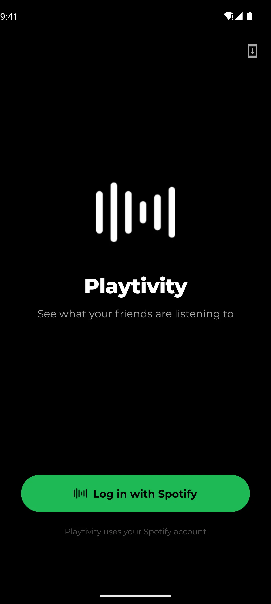
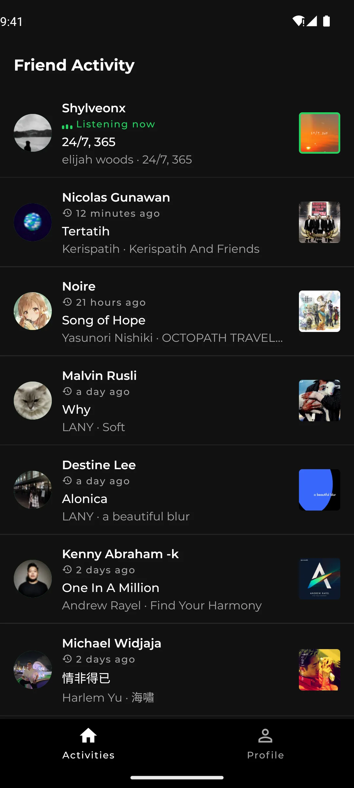
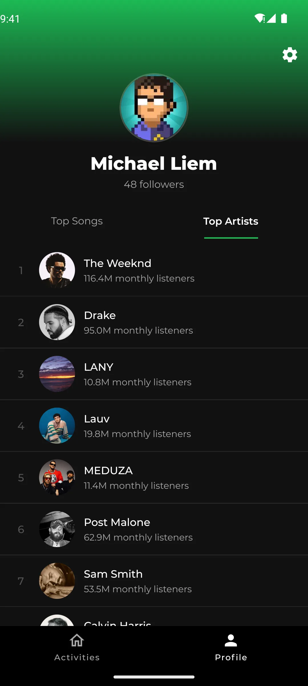
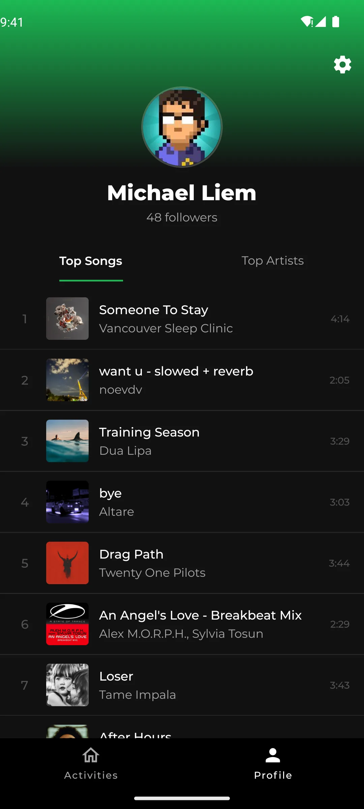
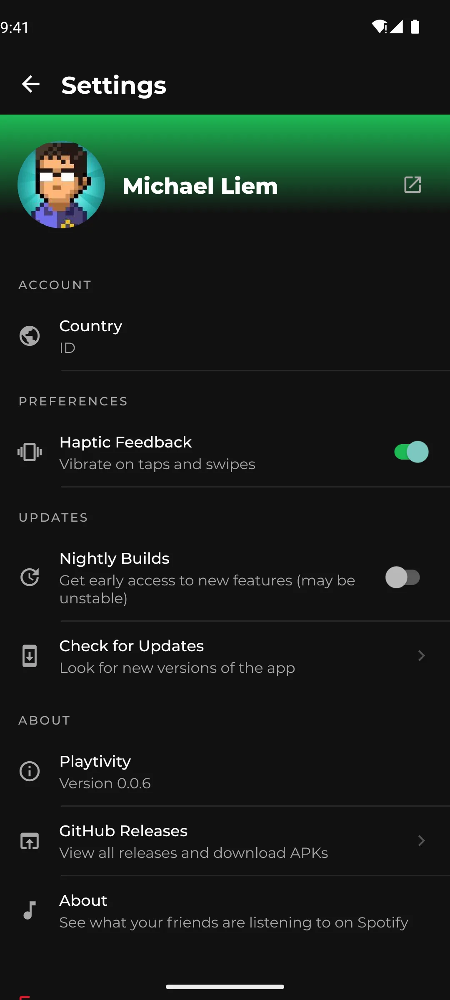

<div align="center">
  

  # Playtivity: Spotify Friend Activity for Android

  A Kotlin Android app that shows your friends' Spotify activity.

  
  
  

  **[playtivity.mliem.com](https://playtivity.mliem.com)**
</div>

## Features

- **Secure Login**: Spotify web login through an embedded WebView
- **Real Friend Activities**: Shows what your friends are currently listening to
- **Profile Dashboard**: Currently playing, top tracks, and top artists
- **Home Screen Widget**: Android widget showing friend activity
- **Spotify Design**: Authentic Spotify dark theme and colors

## Screenshots

These screenshots show the earlier Expo interface. The Kotlin interface is being checked for feature parity.

<div align="center">
  <table>
    <tr>
      <td align="center">
        
        <br><em>Login Screen</em>
      </td>
      <td align="center">
        
        <br><em>Home Screen</em>
      </td>
    </tr>
    <tr>
      <td align="center">
        
        <br><em>Profile - Top Artists</em>
      </td>
      <td align="center">
        
        <br><em>Profile - Top Songs</em>
      </td>
    </tr>
    <tr>
      <td align="center">
        
        <br><em>Settings Screen</em>
      </td>
    </tr>
  </table>
</div>

## How It Works

The app uses Spotify's web login flow to obtain the `sp_dc` cookie, then uses it to request access tokens for Spotify's friend activity API. On upgrade, the Kotlin app attempts to import the cookie from the existing Android WebView cookie store.

> **Note**: This app relies on Spotify's unofficial internal API, tested as of June 2026. Spotify may change or deprecate these endpoints at any time without notice, which could break functionality. There is no guarantee of long-term compatibility.

## Setup

```bash
git clone <repository-url>
cd playtivity
cd native
./gradlew :core:testDebugUnitTest :app:lintPreviewDebug :app:assemblePreviewDebug
```

The preview APK is written to `native/app/build/outputs/apk/preview/debug/`. Production builds use the `production` flavor and read `version.yml`. The existing Expo source remains in the repository while device parity is checked.

## Platform Support

**Android**: Minimum Android 8.0. The Kotlin production APK builds and signs locally; a full device check is still in progress.

**iOS**: Not yet supported. iOS support is planned for a future release. Contributions welcome.

## Roadmap

- [x] API-free implementation
- [x] Home screen widgets
- [ ] Complete Kotlin device parity check
- [ ] iOS support

## Contributing

Bug reports, pull requests, and forks are welcome. [Open an issue](../../issues) to report bugs or suggest features.

## License

MIT — see [LICENSE](LICENSE) for details. Not affiliated with or endorsed by Spotify.

---

Made with ❤️ for music lovers
